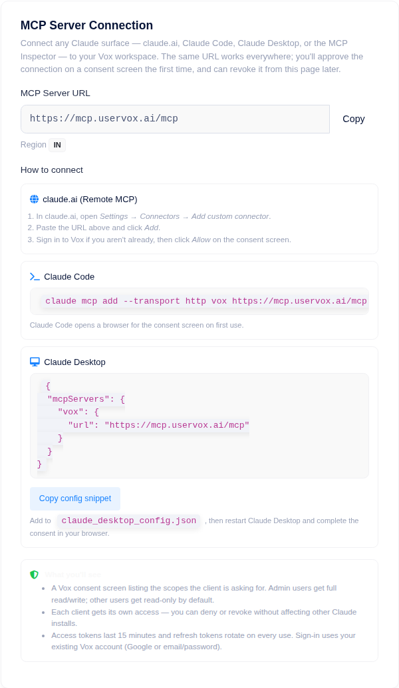

## Overview

Uservox exposes an [MCP](https://modelcontextprotocol.io) server for your workspace, so an AI client — claude.ai, Claude Code, Claude Desktop, or the MCP Inspector — can read and act on your leads, processes, and analytics directly. Every client connects through the same URL and approves access on a consent screen the first time.

Once connected, you can also work with WhatsApp from your AI client: [create templates](/whatsapp/create-template#create-templates-from-claude-mcp) and [send test messages](/whatsapp/send-test-template#send-a-test-from-claude-mcp).

You can also [create and run test cases for your agents](/essentials/test-conversation#do-it-through-mcp) to check prompt changes before and after you make them.

## Where to Connect

Go to **Account Settings → MCP Connection**. You'll find your workspace's **MCP Server URL** and setup instructions for each client:

Per-client steps, including Cursor, VS Code and Codex, are in [Connect your AI client](/essentials/mcp-clients).

## The Consent Screen

The first time a client connects, Vox shows a consent screen listing the scopes it's requesting. A few things to know:

- **Role-based defaults** — Admin users get full read/write access; other users get read-only by default.
- **Per-client access** — each client (claude.ai, Claude Code, a specific Claude Desktop install, etc.) gets its own grant. Denying or revoking one doesn't affect the others.
- **Short-lived tokens** — access tokens last 15 minutes, and refresh tokens rotate on every use.
- **Sign-in** — uses your existing Vox account (Google or email/password), not a separate credential.

You can revoke a client's access at any time from the same **MCP Connection** settings page.
