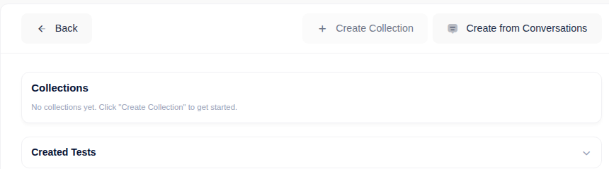

A **test case** replays a real conversation against your agent as it is configured right now, then checks the result against goals you write in plain English, such as "Customer's name is captured" or "Agent confirms the booking". Each run gets a pass or fail for every goal, with the reason.

Use test cases to:

- Lock in a fix: when a call goes wrong, make it a test, change the prompt, and re-run until it passes.
- Catch regressions: re-run your saved tests after every prompt change to make sure nothing that worked before broke.

Each agent can have up to **100 test cases**.

<Note>
A run uses the agent's **live** configuration. To test a prompt change, save the change, then run the tests. This page covers testing an agent's conversation. To dry-run a process's routing and dispositions, see the [Lead Simulator](/guides/process/lead-simulator). To talk to an agent yourself, see [Simulate and Test a Voice Agent](/essentials/simulation).
</Note>

---

## 1. Create a test from a conversation

1. Open the conversation you want to test (`/conversation/:id`).
2. In the **Conversation Messages** header, open the three-dots menu and click **Test Conversations**.
3. The **Test Cases** window lists the tests already made from this conversation. Click **Create New Test Case**.
4. In **Create Test From Conversation**, add one or more goals: what should this conversation accomplish?
5. Click **Create Test**. The new test case opens in a new tab.

{/* Screenshot: Test Cases window with "Create New Test Case" */}

<Tip>
Write each goal as one thing you can check from the transcript: "Agent asks for the preferred visit date", not "Agent handles the call well". Specific goals give clear pass/fail reasons.
</Tip>

---

## 2. Run a test and read the results

The test case page (`/test-case/:id`) shows the agent it belongs to, a **View Source Conversation** link, the test's goals and its results.

{/* Screenshot: test case page, goals panel and Test Results */}

1. Click **Run Test**. The conversation is replayed against the agent's current configuration, which can take a minute or two.
2. The run appears at the top of **Test Results**, marked **PASSED** or **FAILED**. Runs are listed newest first.
3. Expand a run to see:
   - **Conversation Goals**: pass or fail for each goal, with the reason
   - **Replayed Conversation**: the full transcript of this run

Replays aren't always word-for-word the same, because the model's answers and live tool results can change between runs. If a goal passes and fails on different runs with no change to the agent, make the goal more specific or fix the part of the prompt it depends on.

Goals are under **What Should This Conversation Achieve?** To change them or the test's title, click **Edit Goals**, make your changes, and save. The new goals apply to future runs.

---

## 3. Run many tests at once with collections

The **Agent Test Suite** collects all of an agent's tests. To open it, go to **Agents**, open the agent's menu, and click **Test Suite** (`/agent/:id/tests`).



A **collection** is a named set of tests you run together, for example "Booking flow" or "Objection handling".

- **Create Collection**: pick tests that already exist and group them.
- **Create from Conversations**: pick several conversations, add goals that apply to all of them, and Uservox creates a test for each conversation and a collection with all of them in one step.

In the **Collections** table, click the run button in the **Run** column to run every test in a collection. When it finishes, click **Show** in the **Result** column to see each test's result.

<Note>
**Create from Conversations** checks the 100-test limit before it starts. If the conversations you picked would take the agent over 100 tests, nothing is created and you're told how many you can add.
</Note>

---

## 4. Improve an agent with tests

A loop that works well:

1. **Find a bad call.** Look for conversations where the agent got something wrong: a wrong disposition, a skipped step, a wrong answer.
2. **Make it a test.** Write goals that describe what the agent should have done.
3. **Run it.** It should fail, which confirms the test catches the problem.
4. **Fix the prompt.** Change the part of the agent's prompt that caused it.
5. **Re-run the test** until it passes, then **run your collection** to make sure the fix didn't break other calls.

Keep the tests. Every bug you fix becomes a test that guards against it coming back.

---

## Do it through MCP

If you've connected Claude (or another MCP client) to your workspace, as described in [MCP Server Connection](/essentials/mcp-consent), you can run the whole loop by asking in plain language. Claude can find the bad calls, write the tests, edit the prompt and re-run everything.

Creating and running tests needs the **Modify agents and processes** (`write:agents`) scope and the **project admin** role on the agent's project. Project admins get the scope by default when they approve the connection. Users without it can still list tests and read past results.

### Example prompts

> Find yesterday's conversations for my "Service Booking" agent where the customer asked for a pickup and the agent didn't offer one. Make a test case from the worst one, with the goal "Agent offers doorstep pickup when the customer asks", and run it.

> Run all the tests for my "Service Booking" agent and tell me which ones fail and why.

> The pickup test is failing. Read the agent's prompt, suggest the smallest change that fixes it, and show me the edit before you make it.

> Copy the test cases from my Hindi agent to my English agent, then run them there.

### Tools

| Tool | Use it to |
| :-- | :-- |
| `conversations_search` / `conversations_get_transcript` | Find bad calls and read them |
| `add_test_case` | Create a test from a conversation and its goals |
| `run_test_case` | Create a test and run it once, in one step |
| `run_tests` | Run **every** test for an agent and get pass/fail, reasons and tool calls for each |
| `list_test_cases` | List an agent's tests with each one's latest result |
| `get_test_case_runs` | Read past runs of a test (or of every test made from a conversation) without running it again |
| `copy_tests` | Copy tests to another agent, or re-use their goals on a different conversation |
| `agents_get` / `agents_edit_prompt` | Read the agent's prompt and change part of it |

To create a test, give `add_test_case` the conversation's ID and your goals:

```json
{
  "conversationId": "<conversation id>",
  "expectations": [
    "Agent offers doorstep pickup when the customer asks",
    "Agent confirms the pickup date and time"
  ],
  "title": "Pickup request"
}
```

`run_test_case` takes the same input. It creates the test and runs it straight away.

<Warning>
Tests run against the agent's **live** prompt, so a prompt edit made through MCP goes live for real calls as soon as it's saved, before you've run the tests. Ask Claude to show you each edit before making it (`agents_edit_prompt` supports a dry run), run the tests right after, and undo the edit if they fail.
</Warning>

### Things to know

- `run_tests` runs every test for the agent, one after another, and waits for all of them. With many tests this takes a while. To check a single fix, use `get_test_case_runs` on the test you care about after running it, or ask Claude to run only the relevant tests.
- MCP has no tool for collections. Collections are created and run in the dashboard.
- The 100-test limit per agent applies to MCP too. `copy_tests` copies as many as fit and reports the rest as not copied.
- If Uservox manages the prompts for your project, the prompt tools aren't available to you, but you can still create and run tests.
