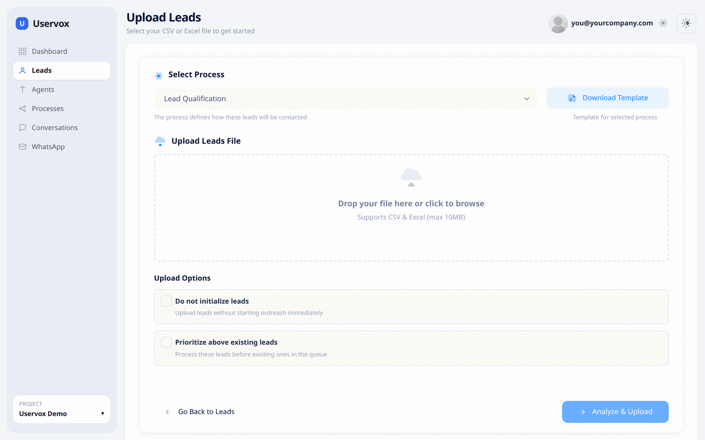
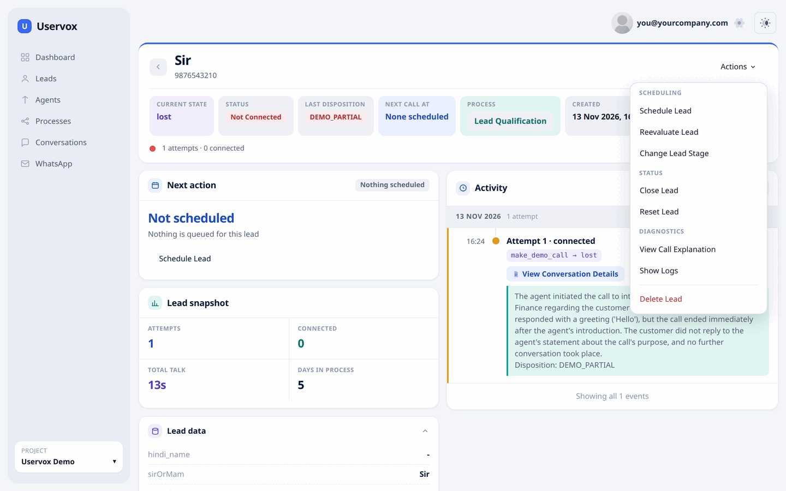

## Overview

Before you send real leads to a process, run it on a number you control (your own, or a teammate's) and take the calls yourself. This is the only test that covers the whole live path: the dialer, the agent's voice, dispositions, retries, and webhooks.

The flow has two parts:

1. **First run:** upload a lead file that holds your test number.
2. **Every run after that:** reset the same lead and initiate it again. You don't need to upload it again.

You can do both in the dashboard or through [MCP](#do-it-through-mcp).

<Note>
To check branching logic without placing a real call, use the [Lead Simulator](/guides/process/lead-simulator). To test a single agent's conversation, use [Test Conversation](/essentials/test-conversation). This page is for a full, live run of the process.
</Note>

---

## 1. Upload a test lead

### Get the file format from the upload page

Each process expects its own columns, which come from the variables its agents use. You don't have to work these out by hand. The upload page builds a template for you:

<Steps>
  <Step title="Open the upload page">
    Go to **Leads** and click **Upload Leads**.
  </Step>
  <Step title="Select the process">
    Under **Select Process**, choose the process you want to test.
  </Step>
  <Step title="Download the template">
    Click **Download Template**, next to the process dropdown. You get an Excel file named `sample-leads-<id>.xlsx`.
  </Step>
</Steps>



The template holds one header row and one example row:

| Column | What to put in it |
| :-- | :-- |
| `name` | The test lead's name. The template's example value is `John Doe`. |
| `phone` | **Your** phone number, the one that should ring. The template's example value is `9123456789`. |
| One column per required process variable, e.g. `openingLine`, `city`, `model` | Realistic values. The agent reads these during the call. If the process already has sample values, the template fills them in; otherwise it puts `Sample Value`, which the agent would speak aloud. |

If the process has no required variables, the template only has `name` and `phone`.

<Tip>
The template only lists **required** variables. If your agent's prompt also uses optional variables, such as a dealer address or an offer amount, add a column for each one so the call sounds realistic.
</Tip>

### Fill it in and upload

1. Replace the example row with your test lead. Keep the header row unchanged.
2. Save the file as `.csv`, `.xlsx` or `.xls` (10 MB max).
3. On the same **Upload Leads** page, with the same process selected, drop the file into **Upload Leads File**.
4. Under **Upload Options**, tick **Prioritize above existing leads** so your test lead goes ahead of the queue. Leave **Do not initialize leads** unticked, otherwise the lead is created but nothing starts.
5. Click **Analyze & Upload**.

The lead is created and the process starts. Your phone rings when the process's first call is due (subject to the process's call window).

<Warning>
Don't re-upload the same file to test again. Uploading a number that's already in the process creates a **duplicate lead**, so you end up with two leads on one number and two sets of calls. To test again, reset the existing lead instead (see the next section).
</Warning>

<Note>
For a quick one-off you can also use **More → Add Test Lead** on the Leads page, where you type in the name, phone and metadata by hand. See [How to upload a test lead](/essentials/upload-test-lead). The template upload is easier when the process has many variables, or when you want to test several numbers at once.
</Note>

---

## 2. Re-run the test: reset and initiate

Once the test lead exists, you can rerun the process on it as many times as you need, for example after you change the prompt or the process.

<Steps>
  <Step title="Open the lead">
    In **Leads**, search for your phone number and open the lead.
  </Step>
  <Step title="Reset the lead">
    Click **Actions → Reset Lead**. This clears the lead's history: its current stage, activities, dispositions, call history, summary and any pending calls. The lead and its metadata stay as they are.

    
  </Step>
  <Step title="Wait for the reset to finish">
    The reset runs in the background. While it runs, the **Actions** menu shows **Reset in progress…**. Wait until that disappears. It usually takes a few seconds.
  </Step>
  <Step title="Initiate the lead">
    Open **Actions** again. **Initiate Lead** now appears at the top of the menu, under **General**. Click it. The lead re-enters the process from the start node, and the first call is placed.
  </Step>
</Steps>

<Warning>
**Reset Lead doesn't restart the process by itself.** After a reset the lead sits idle with no stage, and nothing is called until you click **Initiate Lead**. If you don't see **Initiate Lead** in the menu, the reset is still running or the lead already has a stage. Refresh the page and check again.
</Warning>

<Tip>
To test with different data, for example another city or model, edit the lead's metadata on the lead page **before** you click **Initiate Lead**. The new run uses the updated values.
</Tip>

---

## Do it through MCP

If you've connected Claude (or another MCP client) to your workspace, as described in [MCP Server Connection](/essentials/mcp-consent), you can run the reset-and-re-run loop by just asking. Write actions need the **Modify CRM data** (`write:crm`) scope. Admin users get it by default.

### Reset and re-run in one step

The `leads_bulk_execute` tool with `op: "reset"` resets the lead **and** puts it back into the process. Unlike the single-lead reset, you don't need a separate initiate step. It finds the lead by phone number, so you don't need the lead ID either:

```json
{
  "projectId": "<your project id>",
  "idType": "phone",
  "ids": ["9876543210"],
  "op": "reset",
  "dryRun": false
}
```

- `dryRun` is `true` by default. In that mode the tool only reports which leads would be affected. Run it once that way to check it matched your test lead and nothing else, then run it again with `dryRun: false`.
- The tool returns a `jobId`. Track it with `uploadJobs_get`.

Example prompt:

> Reset the test lead on 9876543210 in my project and restart it. Do a dry run first and show me what it matched.

### Useful tools

| Tool | Use it to |
| :-- | :-- |
| `leads_search` | Find your test lead by phone number and get its lead ID |
| `leads_get` | Check the lead's current stage, last disposition and metadata |
| `leads_bulk_execute` (`op: "reset"`) | Reset the lead and restart the process (see above) |
| `lead_reset` | Reset only. Like **Reset Lead** in the dashboard, this leaves the lead idle until it's initiated. |
| `conversations_list` / `conversations_get_transcript` | Read the test call afterwards |

<Note>
MCP doesn't have a tool for creating new leads. Add the test lead the first time through the dashboard (section 1) or the [Initiate Lead API](/api-integration/leads-initiate). After that, MCP can handle every re-run.
</Note>

---

## Best practices

- **Use a number you control.** Real calls are placed and use credits.
- **Keep one test lead per number per process.** Reset it to test again. Don't upload it again.
- **Check the call window.** If the process only calls during certain hours, a lead initiated outside them waits until the window opens.
- **Review the result after each run.** Open the lead to see the disposition, the transcript and which stage the process moved it to.
