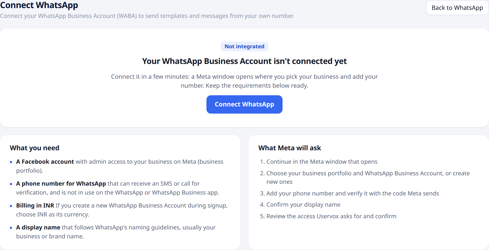
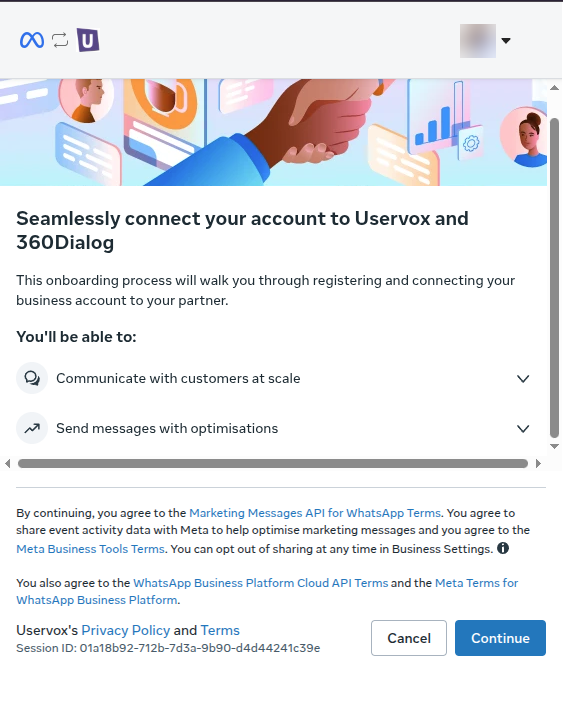
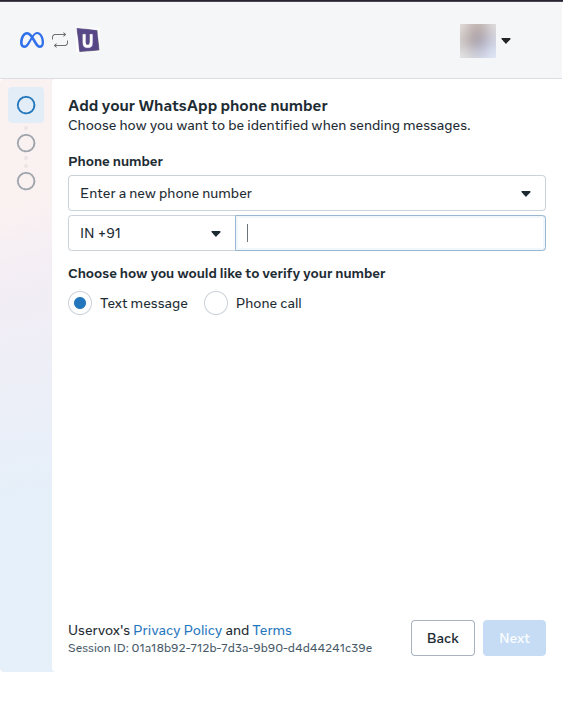
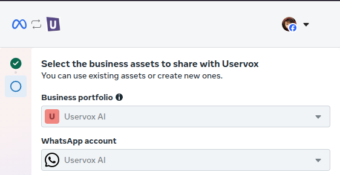
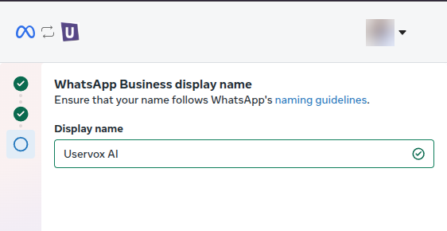
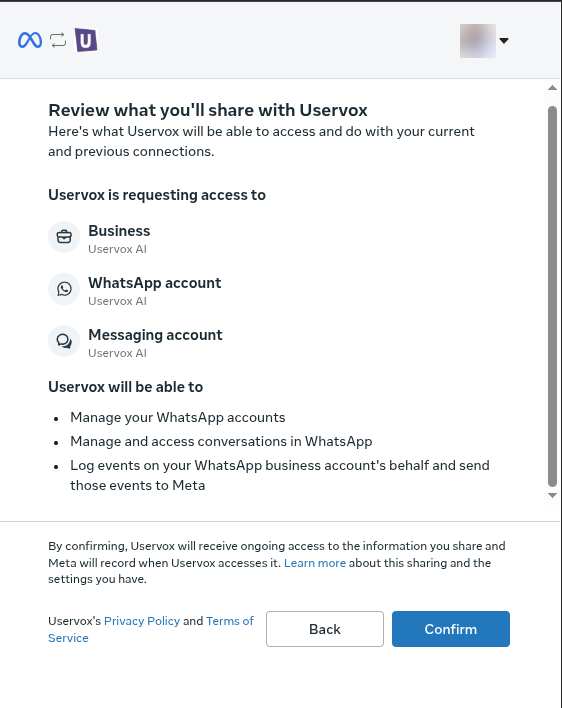

## Overview

To send WhatsApp templates from your own number, connect your **WhatsApp Business Account (WABA)** to Uservox. You do this once per project, in a few minutes, through a short Meta window.

Until a WABA is connected, the **WhatsApp** page shows the onboarding screen below.

---

## Before you start

Keep these ready. If your business doesn't have a company number or a Meta business portfolio yet, start with [Get your business ready for WhatsApp](/whatsapp/prepare-business).

- **A Facebook account** with admin access to your business on Meta (your business portfolio).
- **A phone number for WhatsApp** that can receive an SMS or a call for verification. It must **not** be in use on the WhatsApp or WhatsApp Business app.
- **Billing in INR.** If you create a new WhatsApp Business Account during signup, choose **INR** as its currency. Accounts in other currencies can't be connected.
- **A display name** that follows [WhatsApp's display name guidelines](https://www.facebook.com/business/help/757569725593362), usually your business or brand name.

<Note>
Only a **project admin** can connect WhatsApp. Other members see a message asking them to contact an admin.
</Note>

---

## Connect your account

1. Open [**WhatsApp**](https://app.uservox.ai/whatsapp) from the left menu.
2. Click **Connect WhatsApp**. A Meta window opens.
3. Follow the steps in the Meta window (below).
4. When you click **Confirm** in the last step, the window closes and Uservox starts setting up your number.

### Step 1: Start

Meta explains what you are connecting. Click **Continue**.

### Step 2: Add your WhatsApp phone number

Choose the number you want customers to see, then choose how to verify it: **Text message** or **Phone call**. Enter the code Meta sends you.

### Step 3: Choose your business assets

Select your **Business portfolio** and **WhatsApp account**, or create new ones.

### Step 4: Set your display name

Enter the name customers will see on your messages. A green tick means it meets WhatsApp's guidelines.

### Step 5: Review and confirm

Meta lists the access Uservox needs to send and receive WhatsApp messages for your business. Click **Confirm**.

---

## After you confirm

Uservox registers your number. This usually takes a few minutes, and the page updates on its own, so you can leave it open or come back later.

When the last step shows **Live**, your number is connected. The **WhatsApp** page then opens your conversations, and you can [create your first template](/whatsapp/create-template).

### If setup fails

If something goes wrong, the page shows **Setup failed** with the reason, for example a number that is already registered on another WhatsApp Business Account. Fix the cause and click **Retry WhatsApp signup**.

Common reasons:

| Message | What to do |
| :--- | :--- |
| Billed in a currency other than INR | Run signup again and create a new WhatsApp Business Account in **INR**. |
| Already connected to another project | That account is linked to another Uservox project. Use a different account or ask your Uservox contact. |
| Account was not shared | In the Meta window, select a WhatsApp Business Account in step 3, then confirm. |
| Signup session expired | Run signup again and finish it without long pauses. |

---

## Already sending WhatsApp through another provider?

If your processes already send WhatsApp through another provider, your **WhatsApp** page keeps showing your conversations as before. You can still connect your own WhatsApp Business Account at any time from **WhatsApp → Settings**.
