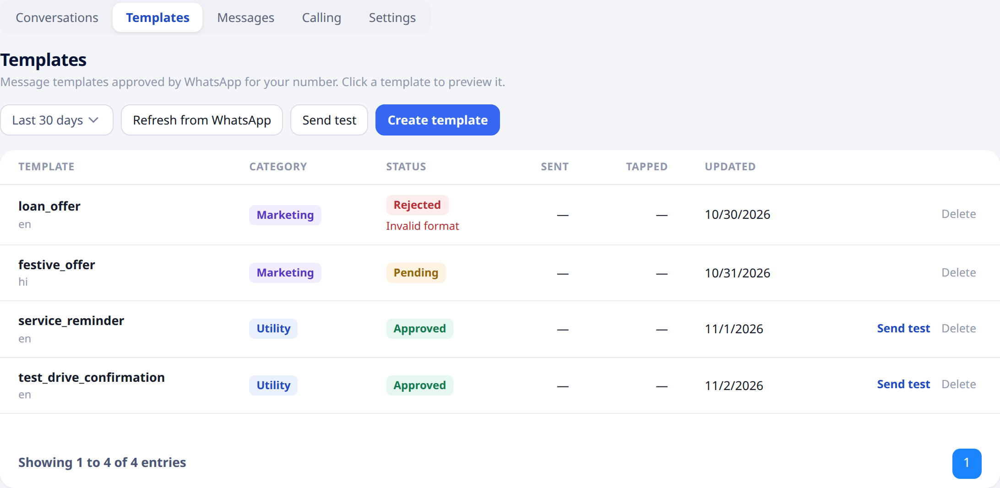
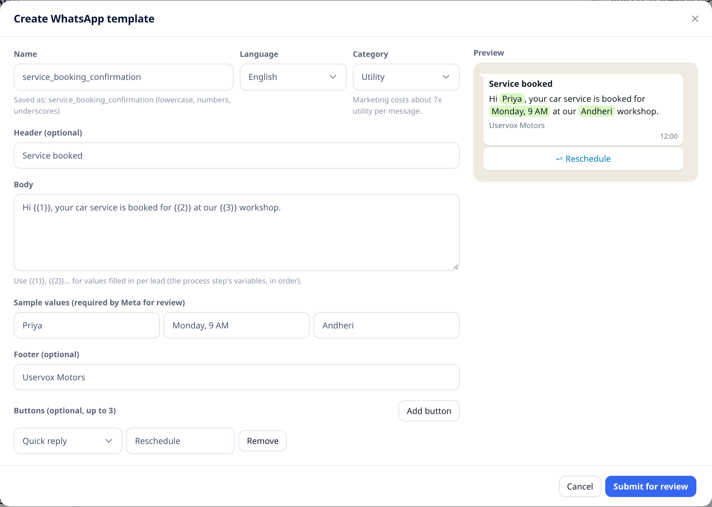
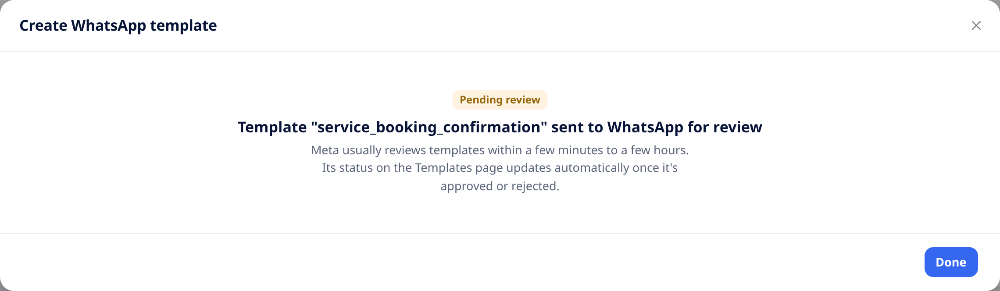
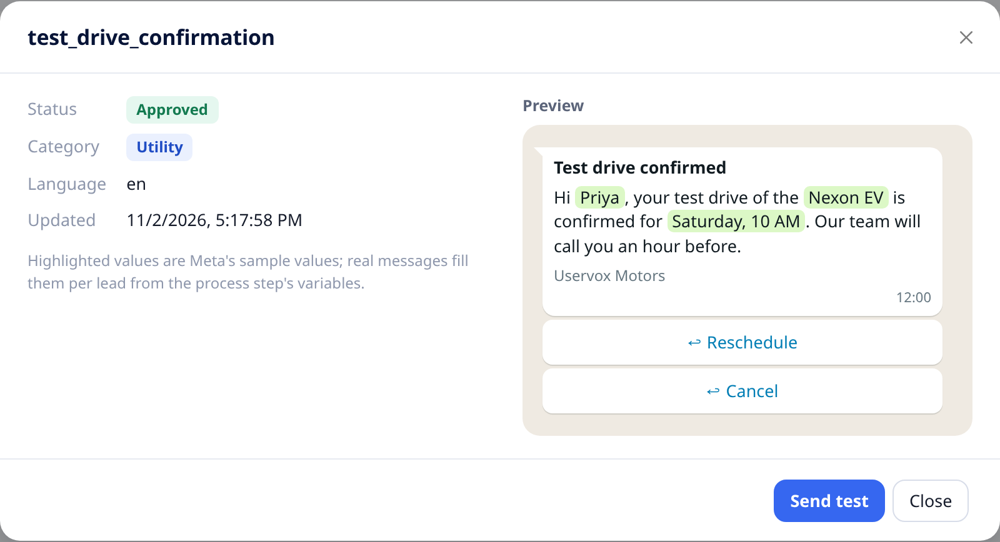
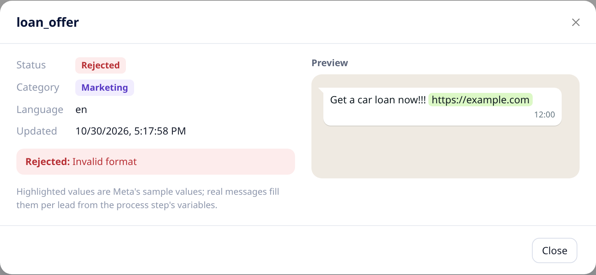

## Overview

A **template** is a pre-approved WhatsApp message. Businesses can only start a WhatsApp conversation with a customer using a template that **Meta (WhatsApp) has approved**. You create templates in Uservox; Meta reviews them.

Templates live under [**WhatsApp → Templates**](https://app.uservox.ai/whatsapp/templates).

Each row shows the template's name and language, its **category**, its **status**, how many messages were sent and tapped in the selected period, and when it was last updated. Click a row to preview the template.

<Note>
Templates need a connected WhatsApp Business Account. See [Connect your WhatsApp Business Account](/whatsapp/connect-whatsapp).
</Note>

---

## Create a template

Click **Create template**. Fill in the form on the left; the **Preview** on the right shows the message as customers will see it, updating as you type.

| Field | Description |
| :--- | :--- |
| **Name** | Lowercase letters, numbers and underscores only, e.g. `service_booking_confirmation`. Other characters are replaced automatically; the form shows the name that will be saved. |
| **Language** | The language the message is written in. Create one template per language. |
| **Category** | **Utility** for updates about something the customer asked for (confirmations, reminders). **Marketing** for offers and promotions; it costs more per message. **Authentication** for one-time codes. |
| **Header** (optional) | A short bold title above the message. It can contain one value, `{{1}}`. |
| **Body** | The main message. Use `{{1}}`, `{{2}}`, `{{3}}`… for values that change per customer, such as a name or a date. |
| **Sample values** | One example for each `{{n}}`. **Required by Meta** to review the template. |
| **Footer** (optional) | A short grey line under the message, e.g. your business name. |
| **Buttons** (optional, up to 3) | **Quick reply** (the customer taps a reply), **Visit website** (opens a link) or **Call phone**. |

When it looks right, click **Submit for review**.

### Tips for getting approved

- Pick the **category** that matches the content. A promotion filed as Utility is usually rejected or moved to Marketing.
- Number values in order (`{{1}}`, `{{2}}`, `{{3}}`) and don't start or end the body with a value.
- Give realistic sample values, e.g. `Priya` rather than `test`.
- Avoid excessive punctuation, all-caps and misleading text.

---

## Approval and status

**Meta (WhatsApp) approves or rejects every template**, usually within minutes and sometimes up to 24–48 hours. The status in Uservox updates on its own when Meta decides.

| Status | Meaning |
| :--- | :--- |
| **Pending** | Waiting for Meta's review. It can't be sent yet. |
| **Approved** | Ready to use in processes and test messages. |
| **Rejected** | Not approved. The reason is shown under the status. Fix the template and create it again. |
| **Paused / Disabled** | Meta stopped the template, usually because customers blocked or reported it. It can't be sent until it's fixed. |

Click a template to see its details and preview. A rejected template also shows the reason.

<Note>
Meta can also change a template's **category** after approval, for example from Utility to Marketing, and rate its **quality**. These changes appear in Uservox automatically.
</Note>

---

## Refresh templates

Statuses update on their own. If a status looks out of date, or you created templates outside Uservox (for example in Meta Business Manager), click **Refresh from WhatsApp**. Uservox fetches the latest list and statuses and shows how many templates were refreshed, or the reason if it couldn't.

---

## Delete a template

Click **Delete** on the template's row and confirm. The template is deleted from WhatsApp too.

<Warning>
After you delete a template, **WhatsApp blocks its name for 30 days**. Use a different name if you need a similar template sooner.
</Warning>

---

## Next step

[Send a test template](/whatsapp/send-test-template) to your own phone to see exactly how it looks.
