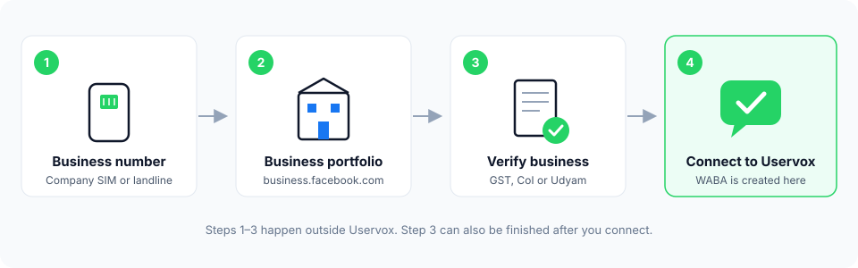
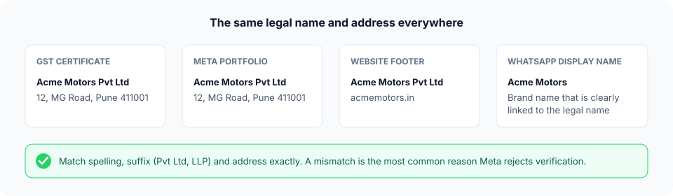

## Overview

A **WhatsApp Business Account (WABA)** is what lets your business send WhatsApp messages from its own number through Uservox. The WABA itself is created for you in the Meta window when you [connect WhatsApp](/whatsapp/connect-whatsapp). Most of the work happens before that, outside Uservox:

1. **Get a business phone number**, usually a company SIM.
2. **Create a Meta business portfolio** for your company.
3. **Verify your business** with Meta using your company documents.
4. **Connect WhatsApp in Uservox.** The WABA is created during this step.

Plan for about a week. Getting a corporate SIM usually takes 1 to 3 working days, and Meta business verification takes from a few days to two weeks. You can connect before verification finishes, but you will be limited to messaging 250 customers a day until it does.

---

## Step 1: Get a business phone number

This is the number your customers will see on your WhatsApp messages. Choose it carefully, because moving a WABA to a different number later means starting your quality rating and message history again.

The number must:

- **Belong to your company.** Use a number the business owns, not an employee's personal number. If that person leaves, you lose access to the number.
- **Be able to receive an SMS or a phone call**, so that Meta can send it a verification code.
- **Not be in use on WhatsApp.** A number already on the WhatsApp or WhatsApp Business app can't be connected. See [If the number is already on WhatsApp](#if-the-number-is-already-on-whatsapp).
- **Not be connected to another WABA**, for example one set up by another provider.

### Option A: A corporate SIM (recommended)

A **corporate postpaid SIM** from Airtel, Jio or Vi is registered in the company's name, so the number stays with the business. Ask the operator's business or enterprise team for a corporate connection. Typical documents are:

| Document | Notes |
| :--- | :--- |
| Company registration | Certificate of Incorporation, partnership deed or LLP agreement |
| GST certificate | Or another registration showing the company's name and address |
| Company PAN | |
| Authorisation letter | On company letterhead, signed and stamped, naming the person who will collect the SIM |
| ID of the authorised person | Aadhaar or another government ID. The operator will do e-KYC for this person. |

<Note>
Each operator has its own checklist, and it can change. Confirm the list with the operator before you visit.
</Note>

You only need the SIM in a phone for the few minutes it takes to receive the verification code. After that, keep the SIM active and safe, because Meta may ask you to verify the number again, for example if you move it to a new account.

### Option B: A landline or an existing company number

A landline or a number from your telephony provider also works, as long as it can receive a call. When you connect, choose **Phone call** as the verification method. Before you start:

- Turn off any **IVR** or **call forwarding** on the number. Meta's automated call has to reach a person who can note the 6-digit code.
- Make sure the number can receive **international calls**. The verification call can come from outside India.

### If the number is already on WhatsApp

Uninstalling the app is not enough. On the phone that uses the number:

1. Back up any chats you want to keep.
2. Open WhatsApp, go to **Settings → Account → Delete my account**, and confirm.
3. Wait at least 5 minutes before you connect the number to Uservox.

<Warning>
Deleting the account removes the number's chat history and groups on that phone. Once the number is on a WABA, it can't be used in the WhatsApp or WhatsApp Business app at the same time.
</Warning>

---

## Step 2: Create a Meta business portfolio

A **business portfolio** (earlier called Business Manager) is your company's home on Meta. Your WABA sits inside it. If your company already runs Facebook or Instagram ads, it probably has one. Ask your marketing team before you create another.

To create one:

1. Sign in to [business.facebook.com](https://business.facebook.com) with your Facebook account.
2. Click **Create a business portfolio**.
3. Enter your business name, your name and your **work email**, then confirm the email.
4. Go to **Settings → Business info** and fill in your company's **legal name**, address, phone number and website.

<Tip>
Add at least one more colleague as an **admin** of the portfolio (**Settings → People**). If the only admin loses access to their Facebook account, nobody can manage your WhatsApp account.
</Tip>

---

## Step 3: Verify your business

**Business verification** is how Meta confirms your company is real. You can connect WhatsApp without it, but until you are verified:

- You can start conversations with only **250 customers a day**. After verification this rises to **2,000**, and Meta raises it further on its own as you keep good message quality.
- Customers may see your phone number rather than your **display name** in some places.
- You can't apply for the **Official Business Account** (the blue tick).

### What you need

- **A website on your own domain** that shows your company's legal name. Meta checks that the business is real by looking at the site, and can verify you through an email address on that domain.
- **One official document** showing the company's legal name and, ideally, its address. For Indian businesses, Meta usually accepts:
  - GST certificate
  - Certificate of Incorporation (from the Ministry of Corporate Affairs)
  - Company PAN card
  - Udyam (MSME) registration certificate
  - Shop and Establishment certificate
  - A recent utility bill or bank statement in the company's name, as proof of address

Sole proprietors usually verify with a GST certificate, or a Shop and Establishment certificate in the business's name.

### Make the details match

Meta compares the name and address on your document with what you entered in the portfolio and with your website. Even a small difference, such as a missing "Pvt Ltd", is a common reason for rejection.

### Start verification

1. In [business.facebook.com](https://business.facebook.com), go to **Settings → Security Center**.
2. Click **Start verification**. If you don't see the button, connect WhatsApp first (step 4) and come back. Meta shows the button once the portfolio uses a feature that needs verification.
3. Check your business details, then upload your document.
4. Choose how Meta should contact you: an **email on your website's domain** (quickest), a **phone call** or an **SMS** to the business number.
5. Enter the code Meta sends you and submit.

Meta usually responds within a few working days. If it rejects your request, it tells you why. Fix the mismatch or upload a different document, then submit again.

---

## Step 4: Connect WhatsApp in Uservox

With your number, portfolio and website ready, follow [Connect your WhatsApp Business Account](/whatsapp/connect-whatsapp). In the Meta window you will:

- choose the **business portfolio** from step 2,
- create a **new WhatsApp Business Account**, with **INR** as its currency,
- add and verify the **phone number** from step 1,
- set your **display name**.

### Choosing a display name

The display name is the name customers see on your messages. Meta reviews it, and it must have a clear link to your business: your company name, a brand you own, or a name that appears on your website. Avoid generic words on their own, such as "Loans" or "Customer Care".

---

## Checklist

<Check>
Before you connect, make sure you have:
</Check>

- A company-owned number that can receive an SMS or call, and isn't on the WhatsApp app
- A Meta business portfolio with at least two admins
- A website on your own domain showing your company's legal name
- A GST certificate or other company document, with the same name and address as the portfolio
- Business verification started in the Security Center
- A display name linked to your business name

Next: [Connect your WhatsApp Business Account](/whatsapp/connect-whatsapp).
