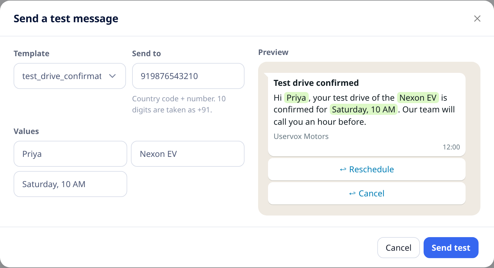
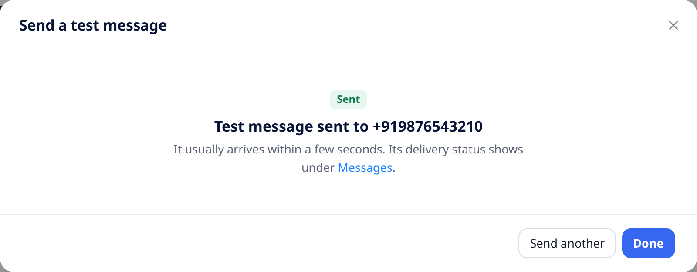
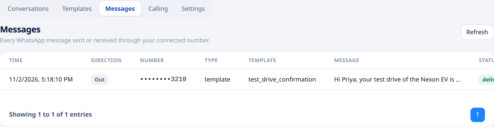

## Overview

Before you use a template with customers, send it to your own phone. You pick an **approved** template, enter a number, fill in the values for `{{1}}`, `{{2}}`…, check the preview and send.

<Note>
Only **project admins** can send test messages. A test message is a real WhatsApp message and is billed like any other.
</Note>

---

## Send a test

1. Open [**WhatsApp → Templates**](https://app.uservox.ai/whatsapp/templates).
2. Click **Send test** next to an approved template. You can also click **Send test** at the top of the page, or open a template and click **Send test** in its preview.
3. Fill in the form:

| Field | Description |
| :--- | :--- |
| **Template** | Only **approved** templates are listed. |
| **Send to** | The phone number with country code, e.g. `919876543210`. A 10-digit number is taken as an Indian number (+91). |
| **Header `{{1}}`** | Shown only when the template's header has a value. |
| **Values** | One box per `{{1}}`, `{{2}}`… in the body, in order. Every value is required. |

The **Preview** shows the message with your values filled in.

4. Click **Send test**.

The message usually arrives within a few seconds. Click **Send another** to try different values, or **Done** to close.

---

## Check delivery

Every test message appears under [**WhatsApp → Messages**](https://app.uservox.ai/whatsapp/messages). Its status changes from **submitted** to **delivered** and **read** as WhatsApp reports back.

---

## If it doesn't send

| Message | What to do |
| :--- | :--- |
| Enter a full phone number with country code | Use the number with country code, e.g. `919876543210`. |
| Fill in every value before sending | Every `{{n}}` needs a value. |
| Only approved templates can be sent | Wait for Meta to approve the template. See [template status](/whatsapp/create-template#approval-and-status). |
| Not supported yet | Test messages don't support templates with an image, video or document header, or with a website button that contains a value. |
| An error from WhatsApp | The message shows WhatsApp's reason, for example a number that isn't on WhatsApp. |
