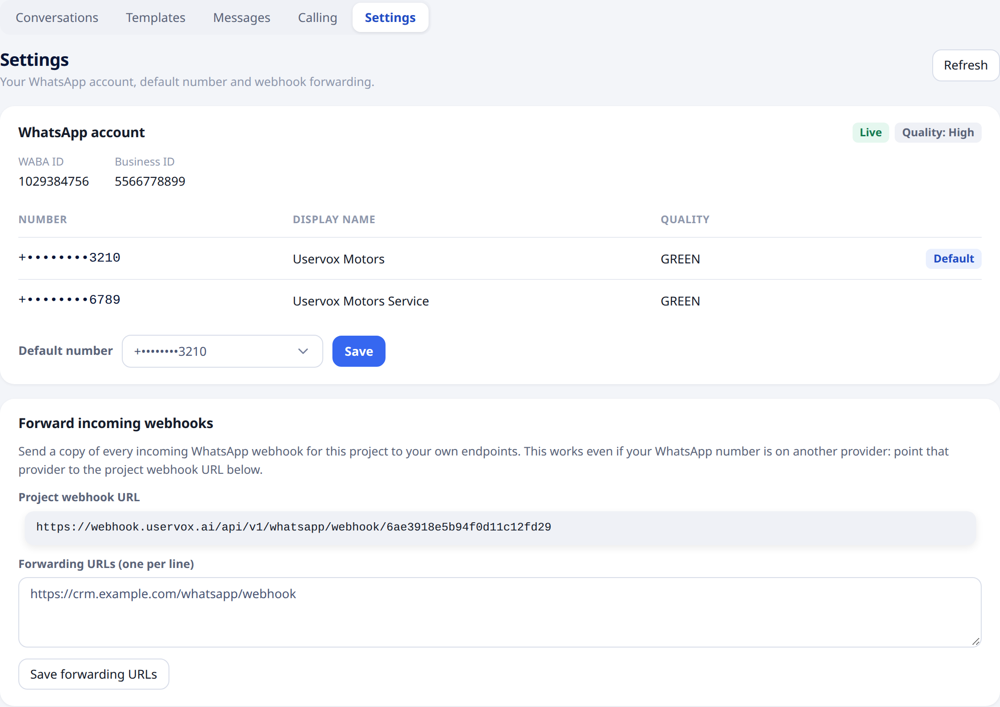
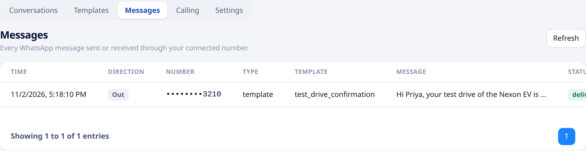

## Overview

The WhatsApp section has five tabs: **Conversations**, **Templates**, **Messages**, **Calling** and **Settings**. This page covers **Settings** and **Messages**.

---

## Settings

Open [**WhatsApp → Settings**](https://app.uservox.ai/whatsapp/settings).

### WhatsApp account

Shows your connected account:

- **Live** and the **quality rating** WhatsApp gives your number.
- Your **WABA ID** and **Business ID**.
- Your numbers with their display name and quality. The **Default** number is used to send your messages.

If your account has more than one number, choose another under **Default number** and click **Save**.

If no WhatsApp Business Account is connected yet, this section shows a **Connect WhatsApp** button. See [Connect your WhatsApp Business Account](/whatsapp/connect-whatsapp).

### Forward incoming webhooks

Send a copy of every incoming WhatsApp event for your project (replies and delivery updates) to your own systems.

1. Enter one or more URLs under **Forwarding URLs**, one per line.
2. Click **Save forwarding URLs**.

To stop forwarding, clear the box and save.

The **Project webhook URL** shown here is your project's own address for WhatsApp events. If your number is on another WhatsApp provider, point that provider to this URL and Uservox forwards the events to your URLs. This works even without a WhatsApp Business Account connected to Uservox.

<Note>
Only **project admins** can change settings. Other members can view them.
</Note>

---

## Messages

Open [**WhatsApp → Messages**](https://app.uservox.ai/whatsapp/messages) to see every WhatsApp message sent or received through your connected number, newest first.

| Column | Description |
| :--- | :--- |
| **Time** | When the message was sent or received. |
| **Direction** | **Out** (sent by you) or **In** (received). |
| **Number** | The customer's number, partly hidden. |
| **Type** | `template` or `text`. |
| **Template** | The template used, for template messages. |
| **Message** | The message text with its values filled in. |
| **Status** | **submitted**, **sent**, **delivered**, **read** or **failed**, as reported by WhatsApp. |
